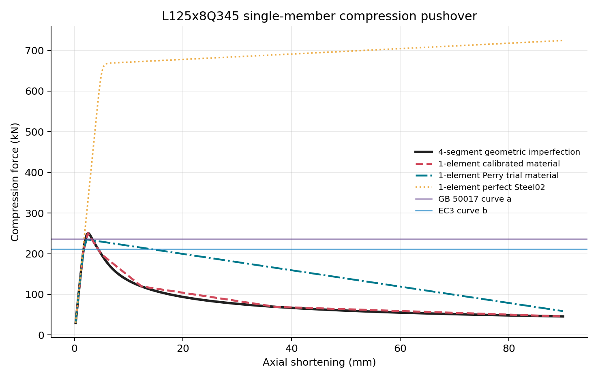
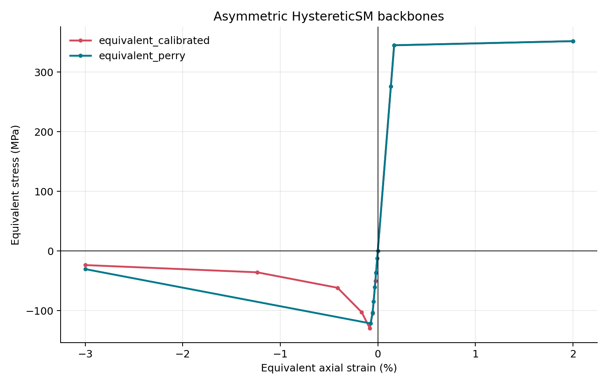
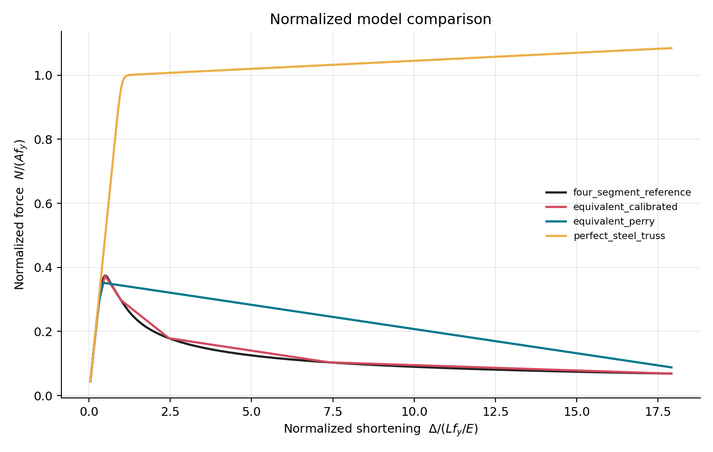
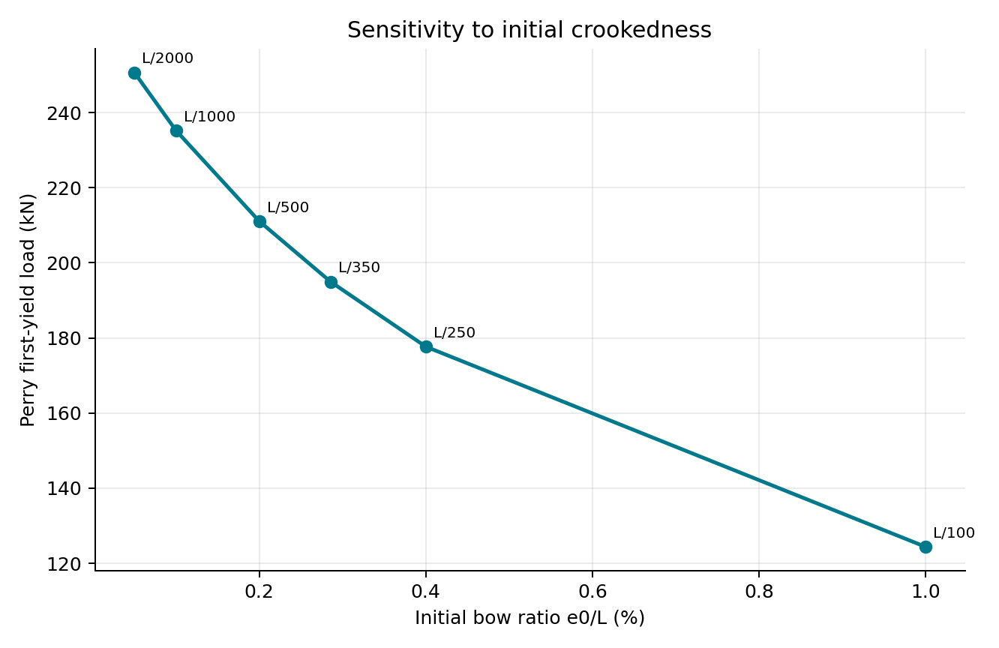

# 初始缺陷等效材料单杆试验报告

## 1. 目的与结论

当前 `model/tower_model_with_buckling.py` 把每根塔杆分成 4 段，在中部节点施加随机横向偏移，再用 `Corotational + forceBeamColumn + Steel02` 表示几何非线性和材料非线性。该方法能显示弯曲变形和杆端内力，但会显著增加全塔节点、单元和积分点数量。

本次另开 `initial_imperfection_material` 模块，先在单杆层面研究一种等效方法：两节点直杆本身不再设置初弯曲，而是把原杆的长细比、初弯曲和压屈后降强折算到一个拉压不对称的 `HystereticSM` 骨架中。

首轮试验表明：

- 四分段基准模型的峰值承载力为 **250.52 kN**；
- Perry 正弦初弯曲理论给出的首次屈服荷载为 **235.21 kN**，OpenSees 单单元计算峰值为 **235.13 kN**，相对基准低 **6.14%**；
- 从四分段曲线自动提取 7 个控制点后，单单元等效材料的峰值和峰值位移与基准一致，全曲线归一化均方根误差为 **2.24%**，曲线面积误差为 **5.26%**；
- 无缺陷 `Steel02` 直杆一直到截面屈服和强化，无法自行发生侧向屈曲，峰值比四分段基准高 **189%**，证明不能只把四段杆改成一个普通 truss。

因此，这条路线值得继续，但当前成果应称为“**等效杆件屈曲本构原型**”，而不是新的 Q345 钢材本构，也还不是已经编译进 OpenSees 核心的 C++ 材料。



## 2. 试件与参数来源

试件直接采用 `Source/Z30103A6.s2k` 中的 `L125x8Q345`：

| 参数 | 数值 | 来源或计算 |
|---|---:|---|
| 杆长 `L` | 3.000 m | 本轮代表性试验长度，可由命令行修改 |
| 截面面积 `A` | 0.001936 m² | S2K `Area` |
| 弱轴惯性矩 `Imin` | 1.193943×10⁻⁶ m⁴ | S2K `I22 - abs(I23)` |
| 弹性模量 `E` | 206 GPa | 当前试验取值 |
| 屈服强度 `fy` | 345 MPa | Q345 |
| 初弯曲幅值 `e0` | 3 mm | 默认 `e0/L=1/1000` |
| 有效长度系数 `K` | 1.0 | 两端铰接试验 |
| 长细比 `KL/i` | 120.80 | 计算值 |
| 无量纲长细比 `λ̄` | 1.5737 | `sqrt(A fy / Ne)` |
| Euler 荷载 `Ne` | 269.72 kN | `π²EI/(KL)²` |
| 截面屈服荷载 `Afy` | 667.92 kN | 计算值 |

四分段对照模型的初弯曲采用确定性的半正弦曲线 `w0(x)=e0 sin(πx/L)`。这里没有沿用全塔代码中的随机方向，是为了让材料标定可重复。

## 3. 力学模型

### 3.1 Perry 初弯曲试算

对两端铰接、具有半正弦初弯曲的杆件，弹性放大后的跨中总挠度取：

```text
e(N) = e0 / (1 - N/Ne)
```

弱轴最外缘首次达到屈服时：

```text
N/A + N e(N) c/Imin = fy
```

程序用二分法求解 `N`。为了使一根轴向 truss 的应变同时包含材料压缩和弯曲导致的弦长变化，采用：

```text
εeq(N) = N/(EA) + π²[e(N)²-e0²]/(4L²)
```

在峰值前取 6 个荷载比例点。峰值后的第 7 点暂取 `ε=-0.03`、残余强度为峰值的 25%。这个峰后比例是**明确的试验假设**，不是规范推荐值；结果也显示它会明显高估大变形阶段的耗能，只适合做初始骨架，不能直接用于全塔。

### 3.2 规范柱曲线检查

程序同时给出两个承载力水平线：

- GB 50017—2017 附录 D 的 a 类曲线：`φ=0.3540`，`φAfy=236.43 kN`；
- EC3 b 曲线（缺陷系数 `α=0.34`）：`χ=0.3165`，`χAfy=211.39 kN`。

GB 50017 的截面分类表将 Q345 轧制等边角钢的 `a*` 按 a 类使用，附录 D 给出 a 类参数 `(α1,α2,α3)=(0.41,0.986,0.152)`。EC3 的柱曲线公式和各曲线缺陷系数可在 JRC 的 Eurocode 3 设计报告中核对。

这两条线仅用于量级和安全性检查，不是对本模型的试验验证。连接偏心、螺栓滑移、局部屈曲和弯扭屈曲都可能改变真实承载力。

### 3.3 标定型等效材料

第二种材料不是人为指定峰后斜率，而是从四分段基准曲线自动取点。当前最多使用 `HystereticSM` 允许的 7 个压缩骨架点：

```text
0.30Δp, 0.65Δp, 1.00Δp, 2Δp, 5Δp, 15Δp, Δmax
```

其中 `Δp` 是四分段模型达到峰值时的轴向缩短。压缩应力和等效应变按 `σ=-N/A`、`ε=-Δ/L` 转换。拉伸支沿用 Q345 的弹性—屈服—小幅强化骨架。单调试验阶段设 `pinch=(1,1)`、`damage=(0,0)`，避免在没有循环试验依据时擅自加入捏拢和损伤退化。

OpenSees 官方说明 `HystereticSM` 每个正、负方向可设置 2～7 个骨架点，且两侧点数可以不同，适合本试验的拉压不对称骨架。若将来需要真正的 C++ 材料，OpenSees 的开发指南要求实现 `setTrialStrain`、`getStress`、`getTangent`、状态提交/回退、复制以及 `sendSelf/recvSelf` 等接口；本轮先把力学假设和目标曲线验证清楚，暂不进入编译维护阶段。



## 4. OpenSees 对照模型

试验包含四组曲线：

1. `four_segment_reference`：4 个 `forceBeamColumn`，半正弦初弯曲，`Corotational` 坐标变换，Q345 `Steel02` 纤维角钢截面；
2. `equivalent_calibrated`：1 个两节点 truss，使用由第 1 组自动标定的 `HystereticSM`；
3. `equivalent_perry`：1 个两节点 truss，使用 Perry 关系生成的试算骨架；
4. `perfect_steel_truss`：1 个两节点 truss，只使用 `Steel02`，作为“忽略屈曲”的反例。

角钢纤维按两个不重叠矩形离散，并旋转到弱主轴方向。所有模型均采用轴向位移控制，压缩至 `Δ/L=0.03`，共 400 步。四分段模型失效后下降支能通过位移控制继续追踪。



## 5. 数值结果

| 模型 | 峰值 / kN | 峰值缩短 / mm | 峰值误差 | NRMSE | 曲线面积误差 |
|---|---:|---:|---:|---:|---:|
| 四分段几何缺陷基准 | 250.52 | 2.475 | — | — | — |
| 标定型等效材料 | 250.52 | 2.475 | 0.00% | 2.24% | 5.26% |
| Perry 试算材料 | 235.13 | 2.250 | -6.14% | 29.95% | 85.95% |
| 无缺陷 Steel02 直杆 | 724.40 | 90.000（计算终点） | +189.16% | 243.49% | 756.77% |

标定模型在峰值附近和长下降段上都与四分段模型接近；Perry 试算模型的峰值合理，但单个假定残余点造成下降段过缓。这一区别很重要：**规范或 Perry 公式适合控制峰值，峰后曲线仍需用四分段模型、壳模型或试验标定。**

标定模型的初始刚度误差为 `-0.52%`；在 `2Δp、4Δp、6Δp` 处的承载力误差分别为 `0.00%、8.58%、5.20%`。这说明 7 点骨架已经能用于单调推覆原型，但在循环加载或要求更精细的峰后耗能时，仍应增加独立标定数据，而不是把 7 点拟合视为最终答案。

单次运行中，四分段基准约耗时 0.57 s，三个单单元模型各约 0.0015 s。这个比值只说明单杆层面的潜在加速，不能直接外推到全塔，因为全塔还包含组装、荷载、收敛和结果记录成本。

## 6. 初弯曲敏感性

Perry 试算中，`e0/L` 从 `1/2000` 增大到当前全塔默认值附近的 `1/100` 时，首次屈服荷载从 250.65 kN 降至 124.40 kN。由此可见，初弯曲幅值不是可随意固定的数值，论文中必须交代来源并做敏感性分析。



建议下一步把实际塔杆按长细比分为若干组，至少扫描 `λ=40、60、80、100、120、150`，并使用 GB 综合缺陷常见分档或实测/文献幅值。当前 `1/1000` 只是便于和单杆理论核对的首轮值；原全塔代码默认 `random_disp_ratio=0.01` 即 `L/100`，影响很大，应在论文建模章节专门论证或调整。

## 7. 能做与不能做的事

等效材料可以：

- 用一个轴向单元近似一根原始杆的 `N-Δ` 峰值和峰后降强；
- 显著减少全塔四分段带来的节点、单元和纤维积分成本；
- 通过 `original_member_id + L + K + section + fy` 建立材料缓存；
- 在后续风时程中记录构件轴力、等效应变和失效状态。

当前原型不能：

- 给出真实的跨中侧移、弯矩分布和屈曲方向；
- 自动表示单角钢连接偏心、弯扭屈曲、局部屈曲或节点滑移；
- 不经重新标定就用于任意杆长、截面或边界条件；
- 同时使用等效材料和几何初弯曲，否则会重复计入缺陷；
- 把同一物理杆再拆成多段并按每段长度生成材料，否则长细比和承载力会被错误改变。

## 8. 推荐的后续开发顺序

1. 从 Z30103A6 中抽取实际杆长分布，对 6 组长细比、4 组初弯曲做批量单杆标定，并形成误差表；
2. 选取塔身主材、斜材各 2～3 根，把单杆等效材料接入一个小塔段，与四分段模型比较推覆曲线和失效顺序；
3. 仅当单调和循环验证都稳定后，建立全塔“每根原始杆一个等效材料/单元”的可选模型类；
4. 若循环风荷载需要刚度退化，再依据试验或高精度模型标定 `damage`、`pinch`，不要直接套用本轮的零损伤参数；
5. C++ `UniaxialMaterial` 放在最后。其价值主要是封装公式、减少 Python 建模开销，并不会替代前面的力学标定。

## 9. 文件与复现

- `material.py`：构件参数、GB/EC3 折减系数、Perry 骨架、四分段曲线采样和 OpenSees 材料注册；
- `experiment.py`：四分段基准、两节点等效模型、误差指标和 CSV/JSON 导出；
- `visualization.py`：4 张 PNG；
- `run_experiment.py`：命令行入口；
- `results/pushover_curves.csv`：全部逐步推覆结果；
- `results/material_backbones.csv`：OpenSees 输入骨架；
- `results/summary.json`：构件参数、理论值、误差和运行时间。

复现命令：

```bash
uv run python -m initial_imperfection_material.run_experiment
```

## 10. 参考资料

1. GB 50017—2017《钢结构设计标准》，第 7.2 节和附录 D：[标准文本镜像（含轧制等边角钢分类）](https://www.steelbuildingtech.com/cdn/https/www.steelbuildingtech.com/Content/upload/pdf/2020739979/GB-50017-2017-Standard-for-design-of-steel-structures.pdf)。
2. Simões da Silva, L.; Simões, R., *Design of Steel Structures*, JRC Eurocodes report：[欧盟委员会 JRC PDF](https://publications.jrc.ec.europa.eu/repository/bitstream/JRC96658/jrc_steel_report_2015_07_22.pdf)。报告给出 EC3 柱曲线、无量纲长细比和缺陷系数。
3. OpenSees, `HystereticSM Material`：[官方文档](https://opensees.github.io/OpenSeesDocumentation/user/manual/material/uniaxialMaterials/HystereticSM.html)。
4. OpenSees, `Steel02 Material`：[官方文档](https://opensees.github.io/OpenSeesDocumentation/user/manual/material/uniaxialMaterials/Steel02.html)。
5. Scott, M. H.; Fenves, G. L., *How to Introduce a New Material into OpenSees*：[PEER/OpenSees PDF](https://opensees.berkeley.edu/OpenSees/NewMaterial.pdf)。
6. Abdelrahman et al., *An effective stress-strain model for angles under axial compression*, Structures 20 (2019) 298–308：[DOI 页面](https://doi.org/10.1016/j.istruc.2019.04.013)。该类研究说明单角钢等效应力—应变方法需要用试验或高精度模型标定。
7. Padilla-Llano et al., *OpenSees simulation of steel column axial cyclic response including local buckling*：[SSRC/AISC PDF](https://www.aisc.org/globalassets/continuing-education/ssrc-proceedings/2015/opensees-simulation-of-steel-column-axial-cyclic-response-including-local-buckling.pdf)。该文证明可用带下降段的单轴材料等效构件屈曲，但其冷弯截面参数不能直接移植到本项目热轧角钢。
