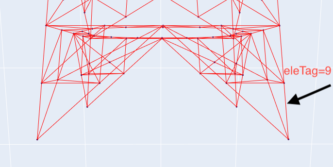
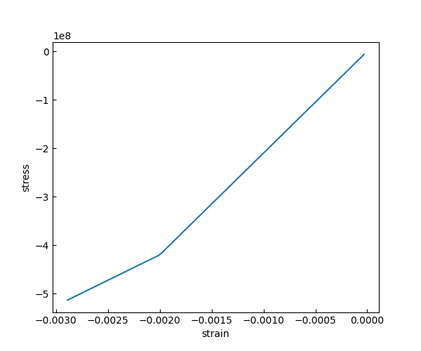
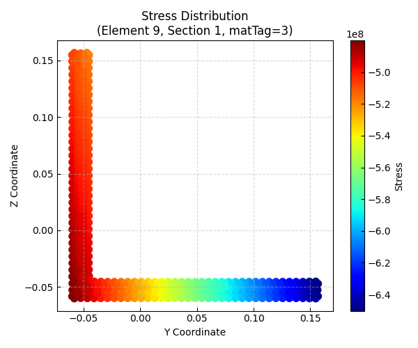
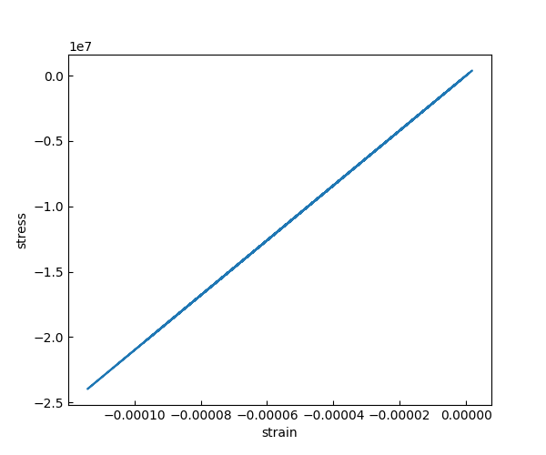
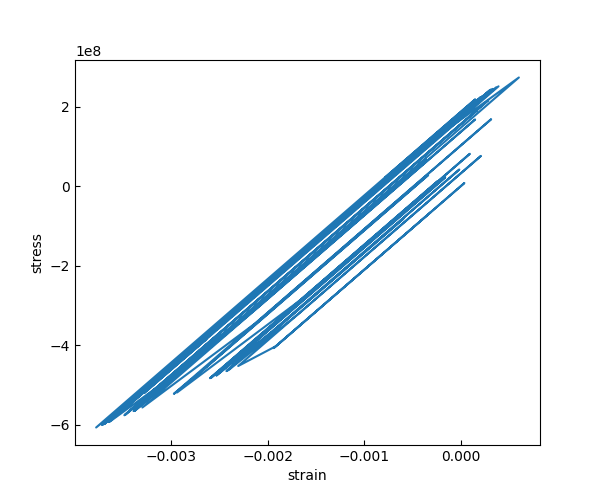

# 此项目用来管理输电塔课题

## 此分支用来考虑风荷载作用

### 继续细分考虑弹塑性材料在脉动风荷载下的作用


1. 定义一种函数关系 load = f(time)  **(这里的load实际只是一种factor乘以后面load内的值才是真正意义上的力)**
```tcl
timeSeries Path $tag -dt $dt -filePath $filePath <-factor $cFactor> <-useLast> <-prependZero> <-startTime $tStart>
```

2. 将函数关系写入pattern
```tcl
pattern Plain $patternTag $tsTag <-fact $cFactor> {
load...
eleLoad...
sp...
...
}
```
### 使用pushover验证应力应变关系提取正确性
提取的杆件



1. 应力应变关系折线图
```py
ops.recorder('Element', '-file', 'opstool/.output/Element9_section1.out', '-time', '-ele', 9, 'section', 1, 'fiber', -0.05, 0.15, 'stressStrain')
```


2. 最后一步应力分布图



### 脉动风荷载下应力应变曲线提取

1. 正常情况下应力应变关系折线图



2. 将荷载扩大20倍



### 全塔应力云图
...
寻找薄弱点针对分析
