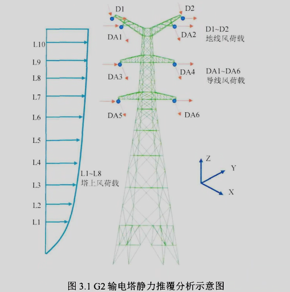
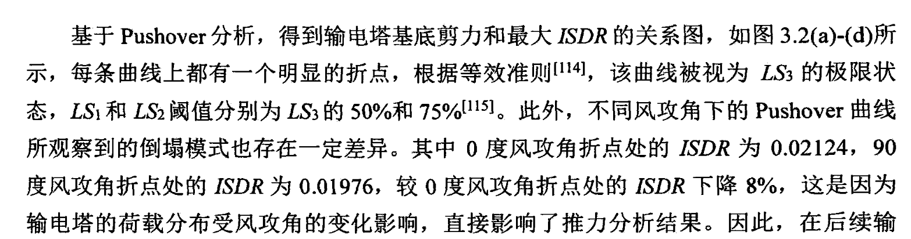
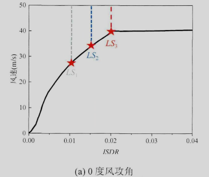
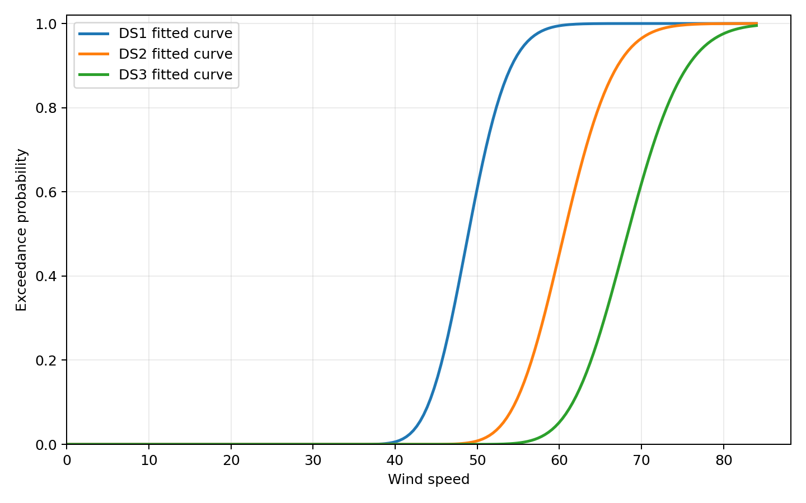
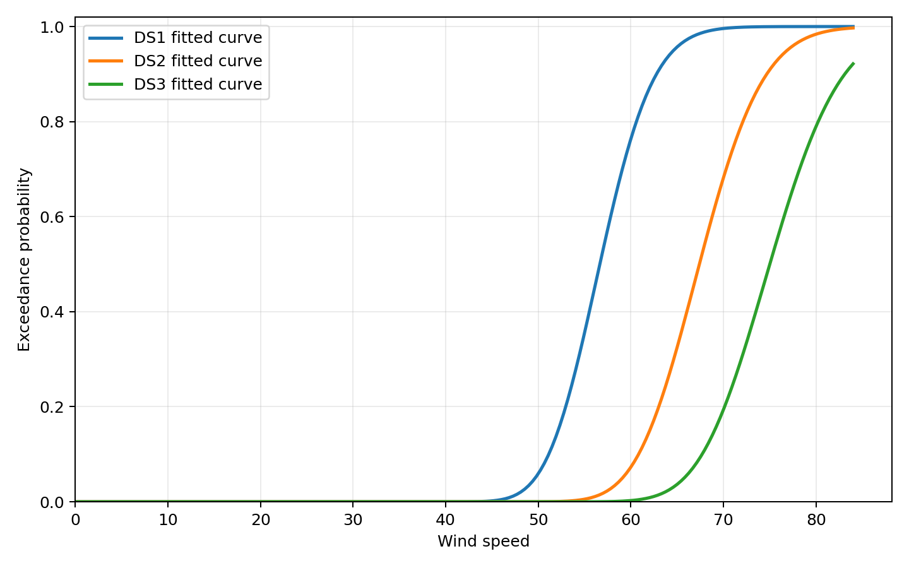
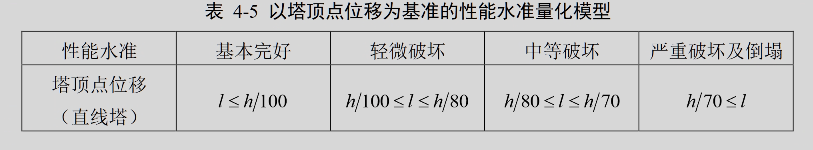
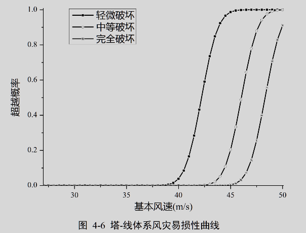
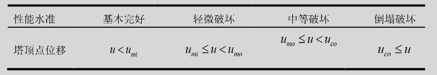
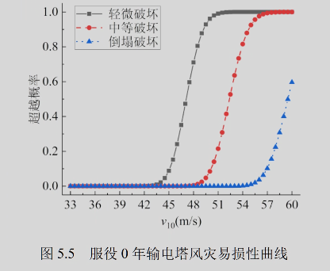
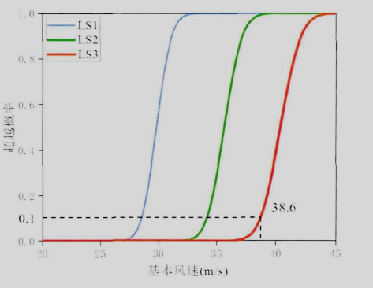

# 易损性分析流程

## 此分支进行易损性分析


### 1.pushover分析，绘制底部剪力和最大ISDR(节间位移角)的关系
加载方式参考  风荷载作用下输电塔-线体系抗倒塌研究



实际结果


### 2.阈值的选取参考 风荷载作用下输电塔-线体系抗倒塌研究



### 3.使用 风速──最大节间位移角 推导易损性曲线


```python

    # 设置节间位移角阈值分别为：
    # 改成数字(如 0.12) -> 使用手动阈值，仅生成一条 DS 曲线
    manual_threshold = [0.00132, 0.00199, 0.00265]
    manual_threshold = [0.25, 0.375, 0.5]

    data_df = extract_input_from_opensees(opensees_out_dir, input_csv)

    model = WindFragilityCurve.from_csv(input_csv, wind_col="wind_speed", disp_col="top_disp")
```
节间位移角阈值参考pushover设定为[0.00132, 0.00199, 0.00265]


和之前使用顶点位移相比较



### 4.别人论文的结果
#### (1)基于性能的输电塔线体系风灾易损性分析(塔高71.9m)
参考标准---塔顶位移


结果



#### (2)盐渍土环境下输电塔风灾易损性分析(塔高72m)

其中mo为屈服时塔顶位移，mi为0.8*mo

易损性曲线



#### (3)风荷载作用下输电塔-线体系抗倒塌研究(塔高204m)

