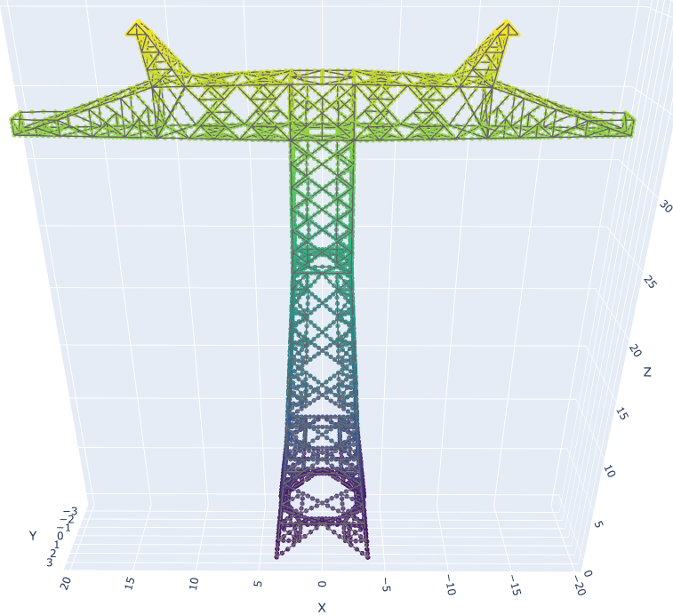
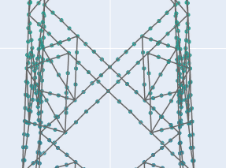
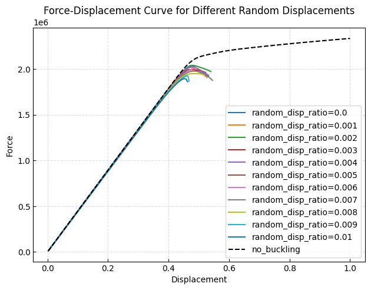
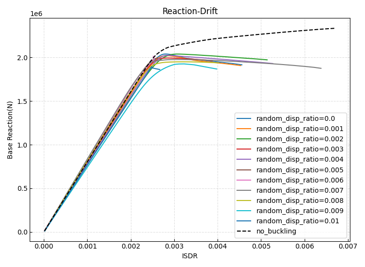
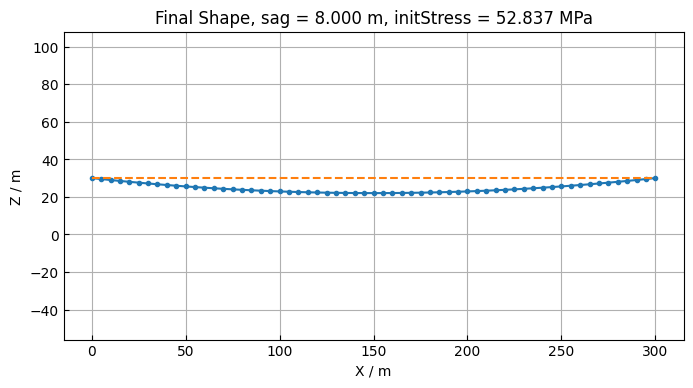
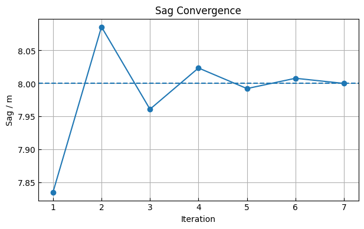
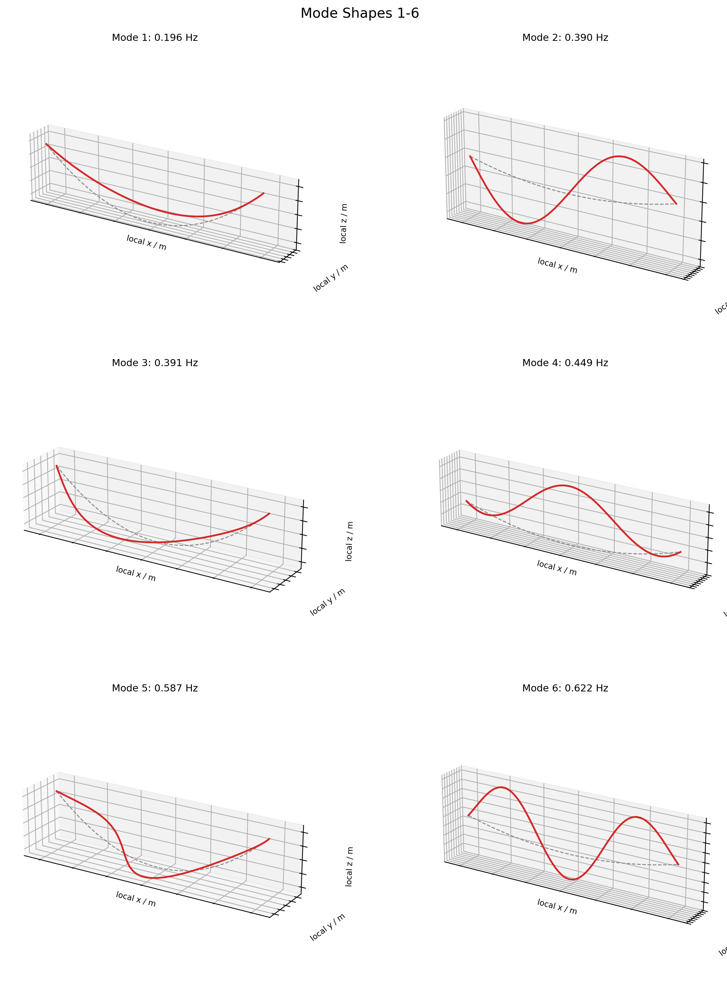

# 易损性分析流程

## 当前成果总览（2026-10-24，redevelop）

本次整理上传从等效初始缺陷材料到 Tian–Ma–Qu（TMQ）单杆、全塔和单塔四跨导线模型的代码、
方法说明、结论报告、任务计划与测试记录。原始计算数据、压缩归档及预生成图表/网页保留在本地。
**完成计算、通过软件测试、通过物理验证是不同状态。**
目前为研究原型，尚不能把求解终点或静态荷载换算风速作为实际线路的倒塌风速。

| 成果 | 当前结果与限制 | 详细入口 |
| --- | --- | --- |
| 等效初始缺陷单杆 | 修正峰前可逆卸载；含网格收敛、实际杆长验证与骨架重构；适用范围仍受标定约束 | [单杆报告](initial_imperfection_material/REPORT.md) |
| 旧等效材料全塔往复与查因 | 保存完整/部分完成算例、关键杆状态与收敛诊断；局部适用域验证不能被整体曲线吻合替代 | [全塔报告](initial_imperfection_material/FULL_TOWER_CYCLIC_REPORT.md)、[收敛诊断](initial_imperfection_material/CONVERGENCE_DIAGNOSIS.md) |
| TMQ 新材料 | 三组单杆完整滞回及原生 OpenSees 桥接；实现文献机制，未完成原作者试验及本塔角钢的定量标定 | [材料说明](initial_imperfection_material/tian_ma_qu/README.md)、[改写报告](initial_imperfection_material/tian_ma_qu/REPORT.md) |
| TMQ 全塔与薄弱位置 | 有界循环完成15/15目标、409步，4根杆进入压屈；扩展循环10/15目标后在最小步长处停止 | [全塔方法](initial_imperfection_material/tian_ma_qu/README.md#独立全塔入口)、[薄弱位置方法](initial_imperfection_material/tian_ma_qu/README.md#参照罗贤超的薄弱位置分析) |
| 风攻角与风速探索 | 单塔和单塔四跨导线分开；45°推覆峰值换算风速约110.98/108.40 m/s，仅代表当前假设下的静态曲线 | [风向加载](initial_imperfection_material/tian_ma_qu/README.md#多风角加载单塔与单塔导线体系)、[风速结论](initial_imperfection_material/tian_ma_qu/README.md#等效风速探索) |
| 塔线模态与B1诊断 | 40→80段指定静位移最大非近零差0.1824%；80段160阶对部分挂点位移重构仍有约14%误差；实际阻尼/瞬态尚未验证 | [B1报告](initial_imperfection_material/tian_ma_qu/followup_results/B1_20261024/REPORT.md)、[模态方法](initial_imperfection_material/tian_ma_qu/README.md#加导线后的初步模态分析) |
| 绝缘子受压复核（新增） | 已有0°/45°保存状态中，约46.03/65.36 m/s首次记录到V串一肢受压；45°峰值处约−10.96 kN，现有模型未模拟松弛或压屈 | [复核方法](initial_imperfection_material/tian_ma_qu/insulator_audit.py)、[小型结论汇总](initial_imperfection_material/tian_ma_qu/followup_results/insulator_audit_20261024/summary.json) |

**下一步优先核对实际挂线与绝缘子几何、受压行为，再重算0°/45°对照。** 当前V串每肢长约9.55 m，
配置中4 m是垂向落差；当前仅两路单根导线、共四跨、远端固定。实际相线/分裂数/地线、邻塔柔度、
垂度与张力条件仍需核实。模态扩阶可改善截断误差，但不能解决上述物理假设问题。
此前B1提出的N06数值计划保留，当前物理核查优先级见[TMQ说明](initial_imperfection_material/tian_ma_qu/README.md#当前塔线模型的物理适用范围2026-10-24)。

### 发布范围与运行

**本次Git提交不附原始数据。** SQLite内力库、逐步CSV/JSONL、模态矩阵/振型、压缩包、论文PDF、
截图及预生成结果页面均留在原工作区。本次也不更新已跟踪的历史原始数据/图像；结论以报告中的日期和工况为准。
历史报告保留本地证据路径用于追溯，这些路径不保证在新克隆中存在。
9999网页在当前工作区仍可读取完整本地结果；新克隆需要重算或另行取得对应数据后才能完整浏览。

```bash
# 安装项目依赖且具备本地结果后启动网页；本机既有服务使用9999端口。
.venv/bin/python -m py_view.results_dashboard --host 127.0.0.1 --port 9999

# 完整测试含本地数据复核，需具备相应数据；原生桥要求详见材料说明。
OPENBLAS_NUM_THREADS=1 OMP_NUM_THREADS=1 TMQ_TEST_NATIVE=1 CXX=/usr/bin/g++-13 \
  .venv/bin/python -m unittest discover -s tests -v

# 不依赖已保存全塔结果的材料、协议、质量逻辑和轴力重建测试。
.venv/bin/python -m unittest tests.test_tian_ma_qu_material \
  tests.test_cyclic_protocol_contract tests.test_result_quality tests.test_tmq_insulator_audit -v

# 仅从已有节点位移重建绝缘子轴力，不进行新的有限元分析；输出目录必须不存在。
.venv/bin/python -m initial_imperfection_material.tian_ma_qu.insulator_audit \
  --output /tmp/otw2_insulator_audit_new
```

本地完整回归468项通过、0跳过；另有7项定向检查，其中6项重复，合计469项独立测试通过。
见[测试汇总](validation/git_publish_20261024/tests.json)、[去重清单](validation/git_publish_20261024/tests_aggregate.json)
及[完整日志](validation/git_publish_20261024/tests.log)。这些结果不表示缺少本地数据的新克隆可直接运行全部证据复核测试。
原生编译缓存和Python字节码不提交，原生桥源码、构建逻辑及固定来源校验保留。
历史报告中的绝对路径记录原计算环境，跨机器运行使用仓库相对路径命令。

通用分析基础模块及使用说明见
[`util/analysis/README.md`](util/analysis/README.md)，包含循环协议、自适应求解、风荷载预检查、
共同区间响应比较与任务状态记录。可运行 `.venv/bin/python -m util.analysis.demo` 验证独立小算例。

后续研究与开发的详细任务书见
[`docs/ai_execution_plan/README.md`](docs/ai_execution_plan/README.md)：包含25项任务、依赖与验收门槛、
机器可读任务清单及可直接交给后续AI的开工提示。计划已开始实施，当前进展与逐角色步骤/结果见
[`执行记录`](docs/ai_execution_plan/execution_20261022/execution_log.md)，具体完成状态以TASKS.json及证据为准，不能将整份计划视为全部已实现。

## 此分支进行易损性分析


### 1.考虑屈曲的输电塔建模

将杆件一分为4，并在中点处添加初始位移，建模如下





### 2.不同初始缺陷下的推覆分析

初始缺陷取 1/1000杆长 的倍数 1/1000 * L , 2/1000*L, ...

结果如下

#### （1）顶点位移


####  (2) ISDR


### 3.等效初始缺陷材料单杆试验

在保留原分段模型作为对照的前提下，新增了
[`initial_imperfection_material`](initial_imperfection_material/README.md) 实验模块。
该模块以 Z30103A6 的 `L125x8Q345` 为试件，对比收敛后的分段几何缺陷杆、
单单元可逆等效材料和无缺陷 `Steel02` 直杆，并输出推覆曲线、卸载验收、
网格收敛、实际杆长验证、材料骨架、缺陷敏感性和误差指标。详细方法及修订结果见
[`initial_imperfection_material/REPORT.md`](initial_imperfection_material/REPORT.md)。

### 4.等效材料全塔往复试验

等效轴向本构已通过保留弹性弯曲、扭转通道的聚合梁截面接入 Z30103A6 全塔，
并与4段几何初缺陷全塔进行了正负0.1%、0.3%、0.6%和1.0%漂移循环对照。
共同完成的正负0.6%范围内，目标点基底剪力最大误差为0.321%，1528根物理杆
轴力包络相关系数为0.999964；但等效模型未能通过后续+1.0%目标，尚不能直接用于
任意强度的循环风振分析。完整方法和结果见
[`FULL_TOWER_CYCLIC_REPORT.md`](initial_imperfection_material/FULL_TOWER_CYCLIC_REPORT.md)。


### 5.输电线建模

下面是早期独立导线找形示例。当前TMQ单塔四跨入口使用初始抛物线垂度与预张力，再进行整体重力平衡，
没有在该入口重新迭代拟合目标垂度；不能用此历史示例宣称当前四跨初态已经按实际线路找形标定。

使用聚合截面命令定义输电线截面，赋予其较大轴向刚度

```python
ops.uniaxialMaterial("Elastic", 1, EA)
ops.uniaxialMaterial("Elastic", 2,nonaxial_stiffness)
ops.uniaxialMaterial("Elastic", 3, nonaxial_stiffness)
ops.uniaxialMaterial("Elastic", 5, nonaxial_stiffness)
ops.uniaxialMaterial("InitStressMaterial", 4, 1, init_force)
ops.section("Aggregator", 1, 4, "P", 2, "Mz", 3, "My", 5, "T")

```

使用有限元找形法，确定输电线重力作用下的位形

1.首先需要确定找形目标，一般来说以输电线最低点弧垂或者最低点轴向应力为找形目标，我这里以弧垂为例进行找形，假定最终弧垂为8m



2.每次开始迭代的初始位形相同，改变的是初始应力的大小，经过7次迭代，最终最低点弧垂收敛到7.9995，结束迭代。



3.输电线模态分析

