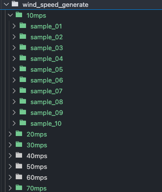
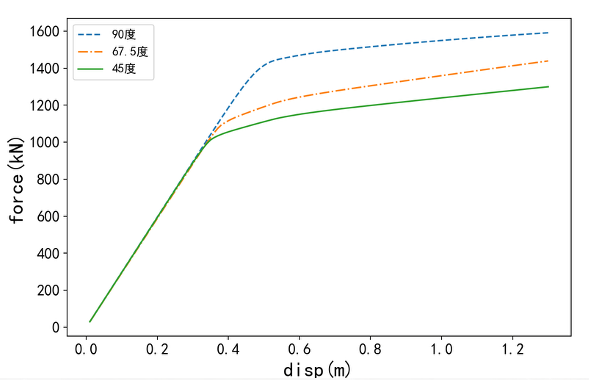
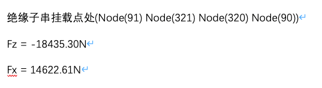
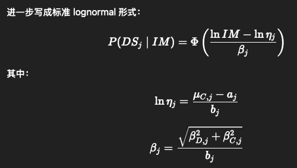
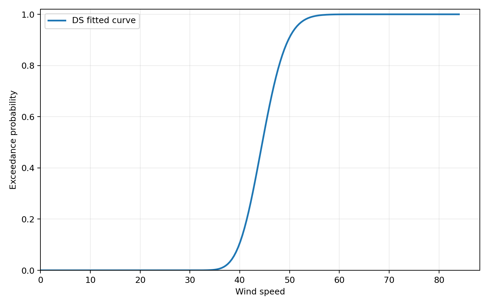
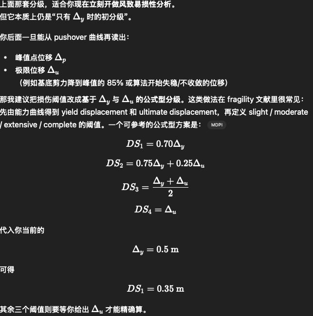

# 易损性分析流程

## 此分支进行易损性分析

### 1.考虑风速不确定性

10m/s - 70m/s 每10m/s 取10个样本



### 2.每次模拟均是8000步，后续考虑缩小模拟时间步长，目前取1000步分析

### 3.阈值选取，参考pushover分析结果（暂时以塔顶位移为例完成分析流程，后续进一步考虑节间位移角）
节间位移角定义存在问题，未消除下层转角对上层影响



塔顶位移为0.5m发生屈服，
后续以塔顶位移0.5m为阈值计算超越概率

### 4.导地线以重力荷载的形式加到节点上，暂时不考虑风对其作用


### 5.使用 风速──塔顶最大位移 推导易损性曲线



```python

    # 手动阈值设置区：
    # 改成数字(如 0.12) -> 使用手动阈值，仅生成一条 DS 曲线
    manual_threshold = 0.5

    data_df = extract_input_from_opensees(opensees_out_dir, input_csv)

    model = WindFragilityCurve.from_csv(input_csv, wind_col="wind_speed", disp_col="top_disp")
```



### 6.改进
#### 参考其它文献，一般是用节间位移角或者塔顶位移（考虑屈服位移和极限位移）作为阈值参考。


